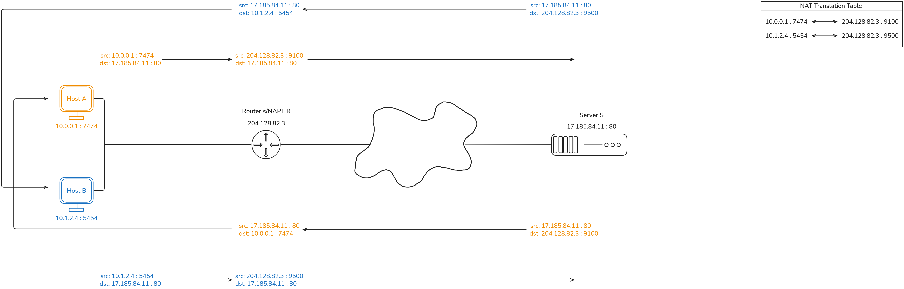
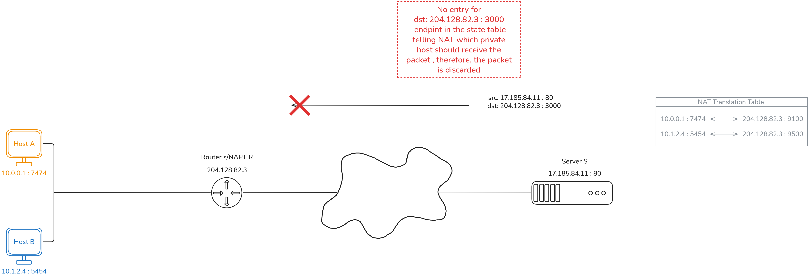
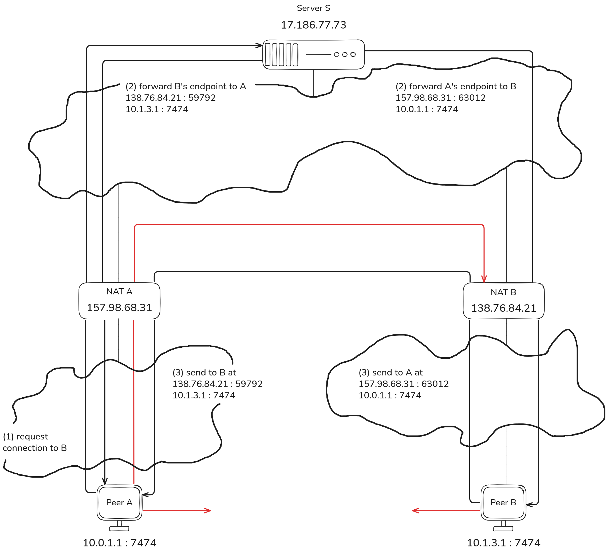
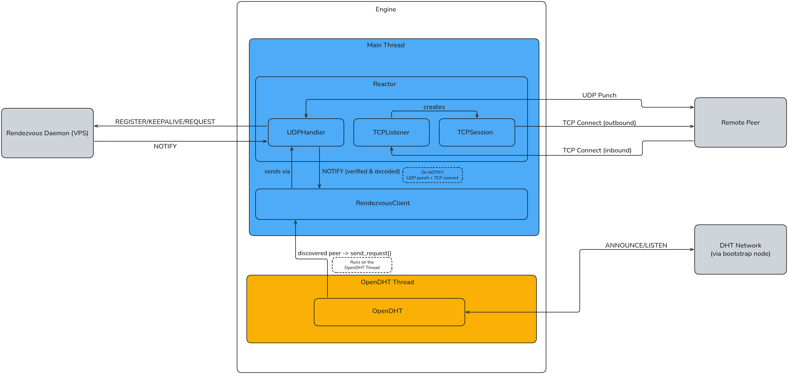

# P2P NAT Traversal Engine

A peer-to-peer Network Address Translation (NAT) traversal and connection-establishment engine

#

Devices behind home Wi-Fi or mobile networks often cannot connect directly to each other. This project helps two peers find and establish a direct connection, working around the obstacles that normally block them.

#

NAT traversal is a critically important issue in modern real-time internet communication, not a solved or trivial one. This project addresses it with Distributed Hash Table (DHT)-based peer discovery (no fixed server list, no manual IP exchange), an authenticated rendezvous protocol that coordinates the connection using HMAC, and UDP hole punching combined with TCP connect. It has been tested on real hardware - a local machine and a VPS - not just in theory. This is the connection-establishment layer: infrastructure for getting peers talking, not a full chat or file-sharing application.

#

NAT is used to modify source and/or destination IP addresses and/or ports. It enables private networks to use the Internet or the cloud. In other words, it translates private IP addresses in a private network to a public network address before packets are sent to an external network. It can also translate port numbers, allowing multiple devices on a private network to share the same public IP address.

The NAT device creates a state/translation entry: private endpoint <-> public endpoint.
If NAT finds a public address-to-private address match in the entry, it translates the destination and forwards the packet.

As for unsolicited incoming packets, if NAT is unable to find a translation entry telling which private host should receive a packet, the NAT device cannot perform the required translation; consequently, the packet is dropped

#

- Event Poll-based single-threaded reactor (Edge-Triggered Notification mode)
- DHT-based peer discovery (Kademlia OpenDHT)
- Authenticated rendezvous protocol (HMAC-SHA256 with replay protection)
- UDP hole punching
- Outbound TCP connection establishment
- NAT keep-alive (periodic refresh so mappings don't expire)

#

Even when peers behind NATs know each other's public endpoints, they cannot necessarily connect directly because each NAT may reject incoming traffic from the other peer until an appropriate NAT mapping has been established. 

If a peer's NAT encounters a packet before it has sent any traffic through it to that specific peer, then that packet may be treated as unsolicited incoming traffic and will be dropped.

UDP hole punching exploits outbound traffic to establish the necessary NAT mappings and filtering state, allowing subsequent packets from the other peer to pass through.

* Adapted from Figure 5 in Ford, Srisuresh & Kegel (2005)
* The red path shows one possible dropped first packet, if it arrives before that peer's own outbound packet has opened its NAT's hole. Since both peers keep sending, each side's hole still opens shortly after, and once both are open, communication proceeds normally in both directions.

## Establishing a connection between peers A and B.

Both peers must have an active UDP *session* with the rendezvous server S. To accomplish that, both clients must register themselves with the server by sending a REGISTER message and letting the server know about their private endpoint (IP and port), so that the server will have both the private endpoint and the public endpoint; the latter is acquired from the translated source endpoint of the packet as observed by the server (usually, the public IP and UDP port that the NAPT assigned to the flow/mapping). If a peer is not behind a NAT/NAPT, its private and public endpoints should be identical [1].

Here, session refers to a software-managed "session built on top of connectionless UDP datagram sockets. The client periodically sends `KEEPALIVE` messages(heartbeat packets) to the server to keep NAT mappings open, thus letting it know that the peer is still alive, and keep NAT/NAPT port mappings alive [1], even though UDP itself establishes no persistent connection or session.

Once an engine knows its public IP, it announces itself on the DHT under the room key and listens for other peers announcing under the same key (see the DHT section below). When an engine discovers a peer, it learns that peer's node ID and sends a `REQUEST` to the rendezvous server S, containing its own private endpoint and the target's node ID. Both peers do this independently and at about the same time, so there is no single initiator and launch order doesn't matter. S already holds both peers' endpoints from registration, and replies with a `NOTIFY` to each peer carrying the other's public and private endpoints. On `NOTIFY`, each engine starts sending UDP packets to both of the other peer's endpoints (the punch) and, at the same moment, attempts a plain outbound TCP connection to the peer's public endpoint.

## Peer discovery with a DHT

The DHT is used solely for peer discovery and has nothing to do with establishing the connection itself. It only lets peers find out that other peers exist, and it provides no mechanism for connectivity, even though it uses UDP under the hood. In this section, "peer" and "node" mean the same thing: a participant in the network.

The engine builds on Kademlia [2], a proven design: BitTorrent's peer discovery is based on it, as are several other large peer-to-peer networks (eMule's Kad network, and libp2p, the networking layer behind IPFS). It uses OpenDHT, a C++ implementation of the Kademlia DHT [3].

The peer joins the network through a public bootstrap node, `bootstrap.jami.net:4222`, the same one used in OpenDHT's own examples [3]. A node can join through any node that is already connected [3], and a Kademlia node needs one such contact to get in [2], so there is no fixed list of peers, but there is one fixed entry point.

The room key `P2P_ROOM_KEY` is hashed into the 160-bit DHT key under which records are stored [3]. It works like a channel name: peers with the same key find each other, and peers with a different key never see each other's records. It is not a secret, and the records are neither signed nor encrypted.

Once the node knows its public IP, it announces itself by publishing a record containing its node ID, public IP, and local TCP & UDP ports, and it listens on the same key. Records expire after approximately 10 minutes unless refreshed [3]; The engine currently announces once. When another peer's record appears, the engine ignores its own record and any record without an IP, and treats the rest as a discovered peer. The record is not enough to connect: the ports in it are local, and the public port is known only to the rendezvous server, so the next step is a `REQUEST` message to that server. OpenDHT runs on its own thread and calls the discovery callback from it [3].

## Architecture

* Engine components and the traffic flow between them. The reactor and `RendezvousClient` run on the main thread. OpenDHT runs on its own thread and invokes the discovery callback, which calls `RendezvousClient::send_request()` to send the request message.

## References

[1] B. Ford, P. Srisuresh, and D. Kegel, "Peer-to-peer communication across network address translators," in Proc. USENIX Annual Technical Conference, 2005, pp. 179–192.  
[2] P. Maymounkov and D. Mazières, "Kademlia: A peer-to-peer information system based on the XOR metric," in Peer-to-Peer Systems: First International Workshop, IPTPS 2002, P. Druschel, F. Kaashoek, and A. Rowstron, Eds., ser. Lecture Notes in Computer Science, vol. 2429. Springer, 2002, pp. 53–65.  
[3] Savoir-faire Linux, "OpenDHT: A lightweight C++17 Distributed Hash Table implementation", GitHub repository. [Online]. Available: https://github.com/savoirfairelinux/opendht. [Accessed: Oct. 11, 2026].    
[4] M. Kerrisk, "THE LINUX PROGRAMMING INTERFACE, A Linux and UNIX® System Programming Handbook", San Francisco, CA, No Starch Press, Inc. 2010, ch. 63, pp. 1355-1367.

## Acknowledgements

Beej's Guide to Network Programming Using Internet Sockets by Brian "Beej" Hall (Revision 2.3.1, 2001).
